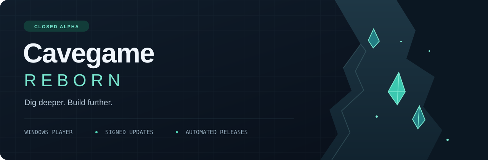

<p align="center">
  
</p>

<p align="center">
  <strong>A Windows game player with signed updates and automated release checks.</strong>
</p>

<p align="center">
  <a href="https://github.com/alexaa1212ss/game/releases/latest"></a>
  
  
  
</p>

<p align="center">
  <a href="https://github.com/alexaa1212ss/game/releases/latest/download/CavegameRebornSetup.msi"><strong>Download for Windows</strong></a>
  &nbsp; · &nbsp;
  <a href="ALPHA-NOTES.md">Alpha notes</a>
  &nbsp; · &nbsp;
  <a href="docs/ENGINEERING.md">Engineering overview</a>
  &nbsp; · &nbsp;
  <a href="https://github.com/alexaa1212ss/game/issues">Report an issue</a>
</p>

---

## Start playing

1. Download **CavegameRebornSetup.msi** from the link above.
2. Install for your Windows account and open **Cavegame Reborn**.
3. Choose a nickname, review and accept the current alpha agreement, and press **Play**.

The player includes its runtime. No separate Node.js installation, development tools, server download, manual configuration, or ZIP extraction is required.

> **Alpha availability:** the current server runs on the operator's PC through a temporary tunnel. It is available while that PC and host are running; 24/7 hosting is not yet in place.

## Explore the alpha

- **Procedural caves and deposits** — explore cave networks, supported mines, and progressively rarer materials.
- **Mining, crafting, and inventory** — build a loadout, gather resources, and develop your progress.
- **Online play** — use a nickname and device identity without an email or password.
- **Persistent progress** — inventory and progress are saved on the game server.
- **Player updates** — release manifests and downloaded files are verified before activation.

See the [alpha notes](ALPHA-NOTES.md) for the current season, gameplay changes, and known limitations.

## Engineering behind the player

| Area | Implementation |
| :--- | :--- |
| Release automation | GitHub Actions builds a per-user Windows MSI and runs installation, update, gameplay protocol, and uninstall checks. |
| Update integrity | Independent Ed25519 signatures plus SHA256 verification for release files and archives. |
| Binary protocol | JavaScript codec with typed fields, variable-length integers, bounded reads, and cached schema writers. |
| Identity protection | Device identity is protected on the Windows account; CI checks preservation across restarts and installer changes. |
| Installer tooling | Node.js generates WiX installer definitions, shortcuts, and maintenance integration. |
| Distribution boundary | Public player artifacts and build tooling are separated from private server data and signing keys. |

Browse the [engineering overview](docs/ENGINEERING.md) for source links, the release flow, and the scope of automated verification.

## Repository map

```text
.github/
  assets/                 Repository and profile artwork
  profile/                Ready-to-use GitHub profile README
  workflows/              Windows player release automation
alpha/                    Release manifests, channels, and file audits
build/                    Installer, reconstruction, and protocol tooling
docs/                     Engineering and contribution documentation
ALPHA-NOTES.md            Current alpha release notes
```

This repository distributes player release files and build scripts. The packaged player input is in `build/player-without-runtime.zip`; it is not a complete standalone server source tree. Private server files, databases, owner keys, and release signing private keys are excluded.

## Identity and recovery

Your login identity stays protected on your Windows account. Export an **encrypted identity recovery file** before replacing your PC. Your online inventory and progress remain on the game server.

## Security and alpha limitations

The installer and launcher are **not yet Authenticode-signed**, so Microsoft reputation warnings may appear. Never disable antivirus or add exclusions. Signed update verification is a separate integrity mechanism; it does not replace Windows publisher signing.

The alpha is evolving. Automated protocol checks do not establish that every visual interaction works on every PC. Interactive installation on another physical PC and browser gameplay still need tester confirmation.

## Feedback and contributions

Found a problem? [Open an issue](https://github.com/alexaa1212ss/game/issues) with your Windows version, player version, reproduction steps, and expected behavior. See [the contribution guide](CONTRIBUTING.md) before sharing logs or changing release tooling.

---

<p align="center">
  <sub>Built and maintained by <a href="https://github.com/alexaa1212ss">alexaa1212ss</a> · Cavegame Reborn</sub>
</p>
