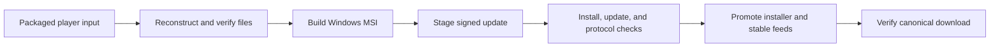

# Engineering overview

Cavegame Reborn's public repository covers Windows player delivery, update metadata, installer construction, and protocol tooling. This guide links the visible implementation without treating private server components as public source.

## Delivery flow

The workflow defines release promotion after its installation and acceptance stages. It also verifies the canonical latest download after promotion. Read the [workflow](../.github/workflows/player-release.yml) for the exact ordering and failure behavior.

## Source tour

| File | What to look for |
| :--- | :--- |
| [protocol-codec.mjs](../build/protocol-codec.mjs) | Schema-driven binary encoding and decoding, integer bounds, size limits, truncated-packet rejection, and writer caching. |
| [make-player-installer.mjs](../build/make-player-installer.mjs) | WiX definition generation, per-user installation, stable component identifiers, shortcuts, and maintenance integration. |
| [ci-reconstruct-player.mjs](../build/ci-reconstruct-player.mjs) | Reconstruction of the player distribution and release integrity verification. |
| [ci-player-acceptance.mjs](../build/ci-player-acceptance.mjs) | Native launcher startup, agreement gating, normal-player login, WebSocket packets, movement, and identity persistence checks. |
| [ci-installer-ui.ps1](../build/ci-installer-ui.ps1) | Windows installer UI automation. |
| [player-release.yml](../.github/workflows/player-release.yml) | Windows build, installation and update checks, artifact publication, and stable channel promotion. |
| [alpha/](../alpha/) | Signed release metadata, file audits, and channel descriptors. |

## Protocol design

The codec uses packet schemas supplied by the reconstructed player payload. It supports fixed-width numbers, strings, booleans, arrays, and variable-length integers.

- Packet buffers have a 16 MiB limit; arrays have a 1,000,000-item limit.
- Reads reject truncated input, and decoding rejects trailing bytes.
- Numeric writers check integer ranges and finite floating-point values.
- Schema field orders and writer closures are cached for repeated encoding.

These are implementation properties in [the codec](../build/protocol-codec.mjs), not a claim that every possible malformed input has been tested.

## Update integrity and Windows identity

The release pipeline reconstructs and verifies player files, stages a signed update, and tests an upgrade from a previous installer before promoting the stable feed. Update manifests use Ed25519 signatures, with SHA256 checks for files and archives.

Acceptance checks assert that the installed native launcher creates a Windows-protected identity, preserves it across restart, and retains identity and agreement state during installer changes. Online progress is stored on the game server.

Update signatures and Windows Authenticode publisher signatures solve different problems. The project's installer and launcher still lack Authenticode signing.

## Reproducing the build

The authoritative build procedure is the [Windows release workflow](../.github/workflows/player-release.yml). It expects the packaged payload, matching release manifests, a Windows runner, Node.js, WiX, and network access.

The protocol codec imports schemas from the reconstructed payload. Running it directly in an untouched checkout will not supply those generated files. This repository is not a generic `npm install && npm start` development setup.

Avoid dispatching release automation merely to inspect documentation: the workflow stages and publishes release artifacts.

## Verification boundaries

The acceptance script checks installed-player behavior through launcher HTTP endpoints and the binary WebSocket protocol. It records browser rendering as unverified.

Second-PC interactive installation, visual movement/mining in the installed player, and further real release update/rollback scenarios require additional tester evidence. See [alpha notes](../ALPHA-NOTES.md) and the acceptance script's `notYetVerified` list for context.
